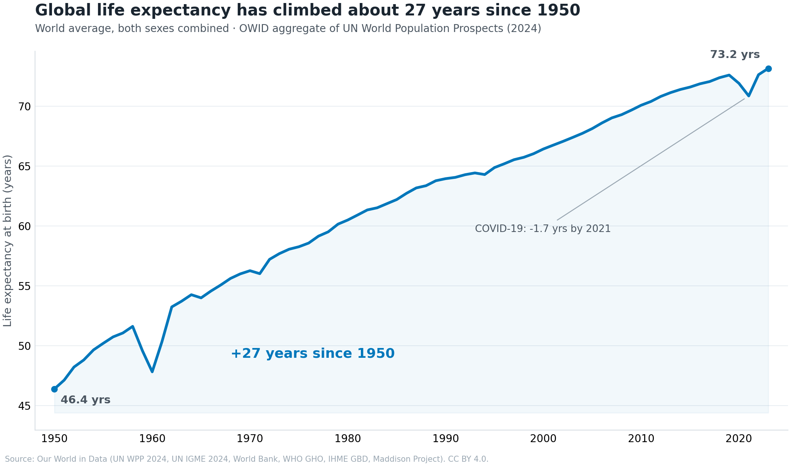
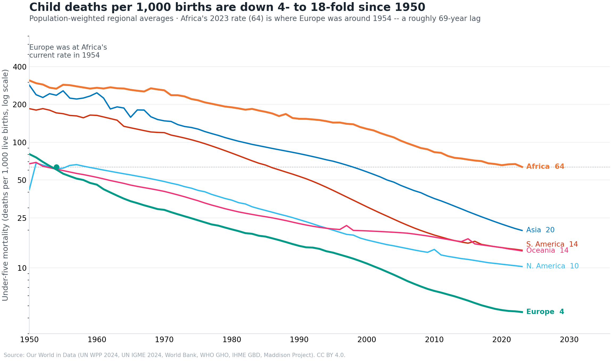
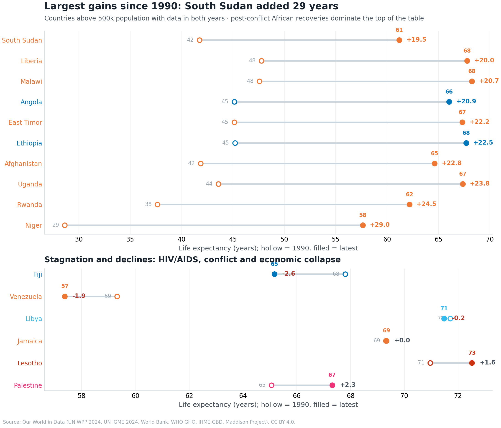
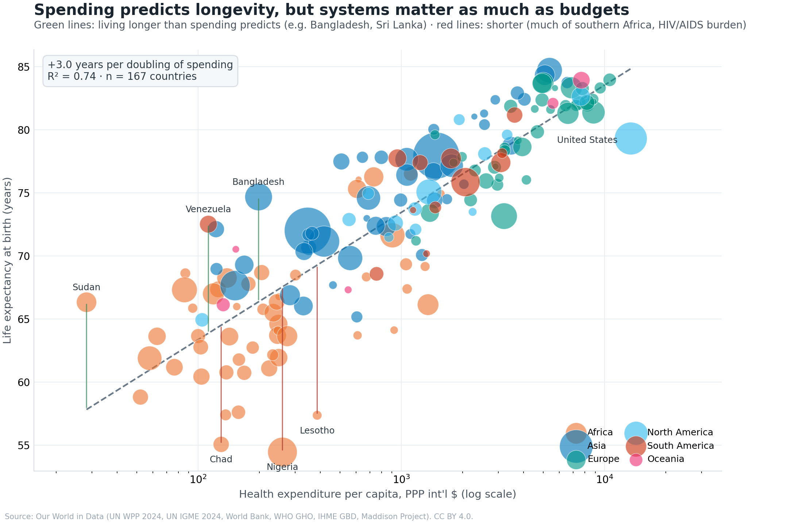
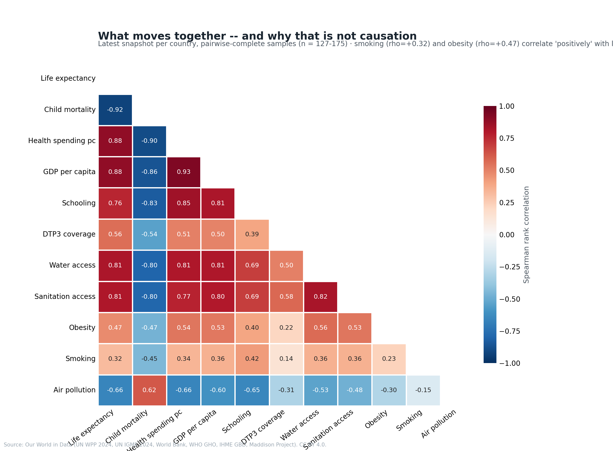

# Public Health Analysis

**Comparing health outcomes across countries and 70+ years of data — and being honest about what the correlations can and cannot say.**


This project takes **thirteen real indicators** from [Our World in Data](https://ourworldindata.org) — life expectancy, child mortality, GDP, health spending, schooling, immunization, smoking, obesity, air pollution, water and sanitation — and works them into a country-year panel of 248 countries and territories, 1950–2024. The analysis lives in six Jupyter notebooks I ran top to bottom in VS Code, built around five questions:

1. How has global life expectancy evolved since 1950?
2. Are countries converging?
3. Who improved most, and who fell behind?
4. How does child survival compare across regions?
5. How do health outcomes relate to socioeconomic context?

The intended audience is a policy/research reader: figures lead with findings, every number on a chart is computed from the data at render time, and the [limitations doc](docs/limitations.md) is treated as a deliverable, not fine print — because the most common failure mode in this genre is quietly implying causation from cross-country correlation.

---

## Key findings

**1. The world gained ~27 years of life expectancy since 1950 — and the gap between countries fell ~40%.**



Every region gained 14+ years. Africa gained the most in absolute terms
(37.5 → 64.2 years) yet still trails Europe by 15. Asia's average (74.5) now
exceeds Europe's 1990 level. Convergence is real but was never smooth: the
HIV/AIDS era plateaued it in the 1990s, and COVID-19 cost the world ~1.8
years before the rebound.

**2. Africa's child-mortality rate today is where Europe's was in 1954.**



Under-five mortality fell from 247 to 38 deaths per 1,000 live births
worldwide (1950 → 2023) — 4- to 18-fold in every region. The remaining burden
is concentrated: 23 of the 27 countries still above 50 per 1,000 are in the
Sahel and equatorial Africa. Africa is improving at ~3% a year; Europe at the
same level, in the 1950s, was moving nearly twice as fast.

**3. Since 1990, post-conflict recoveries dominate the gains list.**



South Sudan (+29 years), Liberia (+25), Malawi (+24), Ethiopia (+22) — the
gains are African rebuilds plus the ART-era HIV recovery. The short list of
decliners (Palestine −2.6, Lesotho −1.9) is epidemics and conflict. The
United States (+3.9) is the pale patch among rich countries in every view of
this data.

**4. Money predicts health — but the residuals are the story.**



Life expectancy rises ~3.6 years per doubling of GDP per capita and ~3.0 per
doubling of health spending (both R² ≈ 0.74–0.75). Bangladesh lives 8+ years
longer than its spending predicts; Nigeria 13 years shorter. The United
States — the largest spender — sits visibly below the line.

**5. The correlation matrix carries its own warning.**



Smoking (ρ = +0.32) and obesity (ρ = +0.47) correlate *positively* with life
expectancy across countries, because income confounds everything. That is
exactly why nothing here is framed as causal — see
[limitations](docs/limitations.md).

The full write-up with all 19 figures is in [docs/findings.md](docs/findings.md).

## Repository structure

```
public-health-analysis/
├── README.md
├── LICENSE                        # MIT (code + docs); data stays CC BY 4.0
├── requirements.txt               # exact versions the notebooks ran with
├── data/
│   ├── raw/                       # 13 OWID CSVs — downloaded manually, gitignored
│   │   └── README.md              # …with the exact download links for every file
│   └── processed/                 # panel.csv etc., written by the notebooks (gitignored)
├── notebooks/
│   ├── data_wrangling.ipynb       # 13 raw CSVs -> tidy country-year panel
│   ├── global_trends.ipynb        # world + regional trends, convergence
│   ├── country_comparison.ipynb   # rankings, movers since 1990, spotlight trajectories
│   ├── child_survival.ipynb       # child mortality, WASH, immunization
│   ├── socioeconomic_links.ipynb  # income, spending, correlations, risk factors
│   └── geographic_analysis.ipynb  # four choropleth maps
├── figures/                       # the 19 PNGs the notebooks save (committed)
└── docs/
    ├── data_dictionary.md         # panel schema + raw file map + quirks
    ├── findings.md                # the full analysis write-up
    └── limitations.md             # what this analysis cannot support
```

## Getting started

```bash
git clone https://github.com/SohaibSaleh77/public-health-analysis.git
cd public-health-analysis

python -m venv .venv && source .venv/bin/activate   # Windows: .venv\Scripts\activate
pip install -r requirements.txt
```

Then:

1. **Get the data.** The raw CSVs are not part of the repo — grab the
   thirteen files listed in [`data/raw/README.md`](data/raw/README.md)
   (direct download links included) and drop them into `data/raw/`. Takes
   about two minutes.
2. **Run the notebooks in order**, top to bottom — I use VS Code's notebook
   editor; Jupyter Lab works identically. `data_wrangling.ipynb` builds
   `data/processed/panel.csv` (about half a minute); every later notebook
   reads it. Each one saves its figures to `figures/` as it goes.

`geographic_analysis.ipynb` renders its choropleths with plotly + kaleido. kaleido needs a
Chrome/Chromium binary on your machine — if you don't have one, `pip install
kaleido` and run `plotly_get_chrome`, or point the `BROWSER_PATH` environment
variable at an existing browser binary. Everything else is pure matplotlib.

## Data & sources

All indicators are from **Our World in Data** and licensed **CC BY 4.0**
(downloaded October 2026). Primary sources: UN World Population Prospects
(2024), UN IGME (2024), Maddison Project Database (2023), WHO Global Health
Expenditure Database, WHO/UNICEF WUENIC and JMP, WHO Global Health
Observatory, IHME Global Burden of Disease (2019).

Coverage at a glance (full detail in the
[data dictionary](docs/data_dictionary.md)):

| Indicator | Countries | Years |
|---|---|---|
| Life expectancy | 237 | 1950–2023 |
| Under-five mortality | 201 | 1950–2024 |
| GDP per capita (Maddison) | 169 | 1950–2022 |
| Health spending per capita | 193 | 2000–2024 |
| Air pollution mortality | 183 | 2019 only |
| …and 8 more | | see the data dictionary |

## Methodology in one paragraph

Regional averages are population-weighted (an unweighted mean lets Tuvalu
count as much as China); "latest value" cross-sections use a 5-year window
anchored at each indicator's own latest year, with reference years carried
along because vintages differ across sources; convergence is measured on a
balanced panel of 237 countries so falling dispersion cannot be a composition
artefact; correlations are Spearman rank (the relationships are monotone but
strongly non-linear); fitted lines are descriptive OLS on log income,
reported in per-doubling units. The reasoning behind each choice — plus every
data quirk I hit — is documented in the notebooks themselves and in
[docs/limitations.md](docs/limitations.md).

## Limitations (the short version)

- **Nothing here is causal.** The smoking/obesity positive correlations with
  longevity are the built-in demonstration of why.
- Cross-sections mix vintages (GDP 2022, life expectancy 2023, air pollution
  2019).
- GDP (2011 PPP $) and health spending (current PPP $) are not
  level-comparable.
- Missingness is not random: late reporters are disproportionately poor and
  conflict-affected.
- Country-level analysis invites ecological fallacy; life expectancy is not
  healthy life expectancy; air-pollution figures are modelled estimates
  without displayed uncertainty.

The full list, with reasoning and consequences, is in
[docs/limitations.md](docs/limitations.md).

## Citation

If you build on this, cite the data providers alongside:

```bibtex
@misc{owid,
  author = {{Our World in Data}},
  title  = {Our World in Data — Health datasets},
  year   = {2026},
  url    = {https://ourworldindata.org},
  note   = {Data downloaded October 2026, CC BY 4.0}
}
```

## Author

**Sohaib Abdo Ahmed Saleh** — [SohaibSaleh77](https://github.com/SohaibSaleh77)

## License

- **Code and documentation:** MIT — see [LICENSE](LICENSE).
- **Data:** the files fetched into `data/raw/` are from Our World in Data,
  licensed CC BY 4.0. The attribution requirement propagates to any figure or
  table derived from them — every figure footer in this repo carries it.
