# Findings

What the data says, question by question. Every number below is computed in
the notebooks — the relevant cell is never more than a scroll away — and
statements about *association* are descriptive throughout. The causal caveats
live in [`limitations.md`](limitations.md) and apply to everything here.

---

## Q1. How has global life expectancy evolved since 1950?

*(All 19 figures live in `figures/`; each section names the notebook that
produces them, where every number can be traced back to a cell.)*

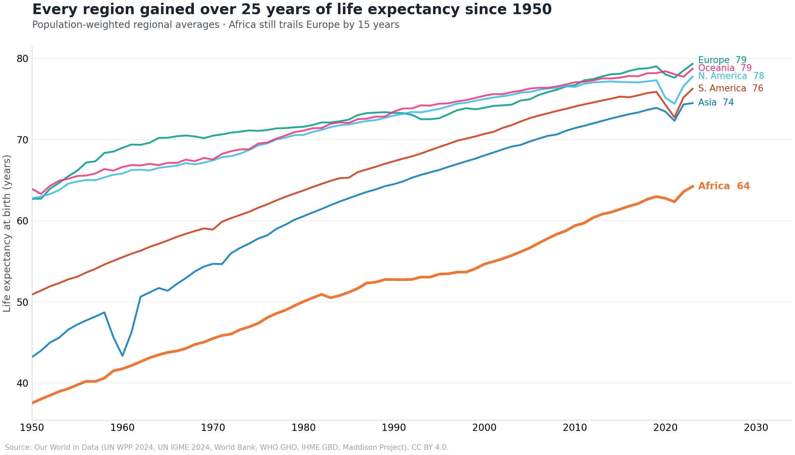
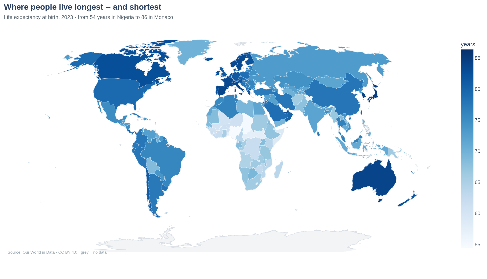

**The world gained about 27 years of life expectancy in 73 years — the
fastest sustained improvement in recorded health history.**

World life expectancy at birth rose from 46.4 years in 1950 to 73.2 in 2023
(global_trends.ipynb). The gain was not smooth: the HIV/AIDS era slowed African
progress in the 1990s, and COVID-19 interrupted everyone — world life
expectancy fell about 1.8 years between 2019 (72.6) and its 2021 trough
(70.9), erasing roughly a decade of progress before rebounding past its
pre-pandemic level by 2023.

Regionally (population-weighted), every continent gained 14 years or more:

| Region | 1950 | 1990 | 2023 |
|---|---|---|---|
| Africa | 37.5 | 52.7 | 64.2 |
| Asia | 43.2 | 64.5 | 74.5 |
| South America | 50.9 | 67.3 | 76.2 |
| Europe | 62.7 | 73.3 | 79.3 |
| North America | 62.7 | 73.0 | 77.7 |
| Oceania | 63.9 | 73.4 | 78.7 |

Two observations a policymaker should take from this table. First, Asia's
2023 average (74.5) now exceeds where Europe stood in 1990 — the "developing
world" category has dissolved. Second, Africa gained 26.7 years since 1950 —
more than any other region in absolute terms — yet still trails Europe by
15.1 years. Progress and disparity coexist.

## Q2. Is the world converging?

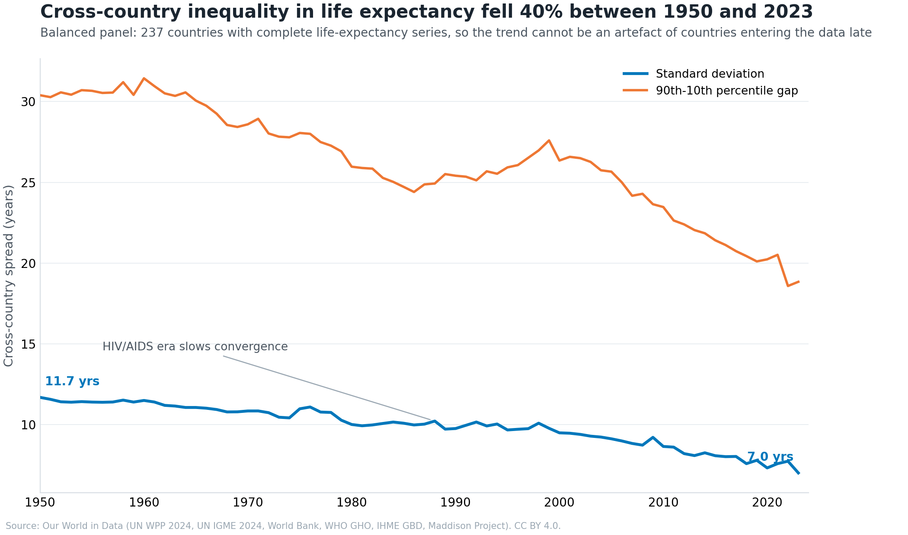
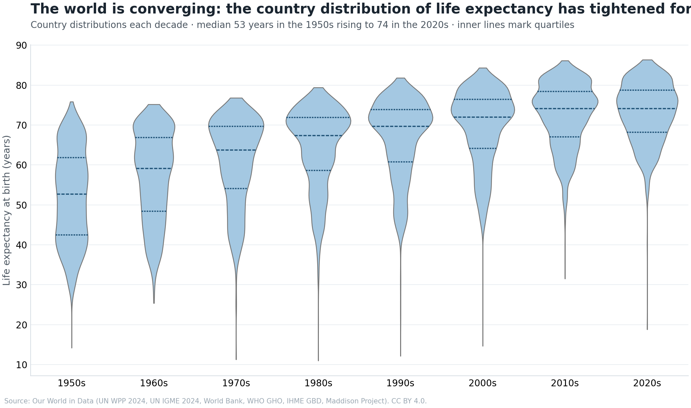

**Yes, substantially — cross-country inequality in life expectancy fell
roughly 40% since 1950.**

- The standard deviation of life expectancy across a **balanced panel of 237
  countries** (countries with data in *every* year, so the trend can't be a
  composition artefact) fell from 11.7 years (1950) to 7.0 (2023); the
  90th–10th percentile gap fell from 30.4 to 18.8 years.
- The country distribution has visibly tightened every decade: the 1950s' long
  lower tail of countries below 40 years has vanished; the median country
  rose from 53 to 74 years.
- Convergence was **not monotonic**. The AIDS era (the dispersion plateau
  around 1985–2005) shows what happens to convergence when one region suffers
  a shock the others do not — a caution against extrapolating any trend line
  through a pandemic or epidemic.

Convergence in *levels* has a structural limit worth naming: the leading
countries sit in the mid-80s (Hong Kong 85.5, Japan 84.7, South Korea 84.3 in
2023, per the rankings table in country_comparison.ipynb). Unless the frontier keeps
moving, catch-up countries compress against that ceiling — dispersion can
fall while gaps in *healthy* life expectancy do not.

## Q3. Who improved most — and who fell behind?

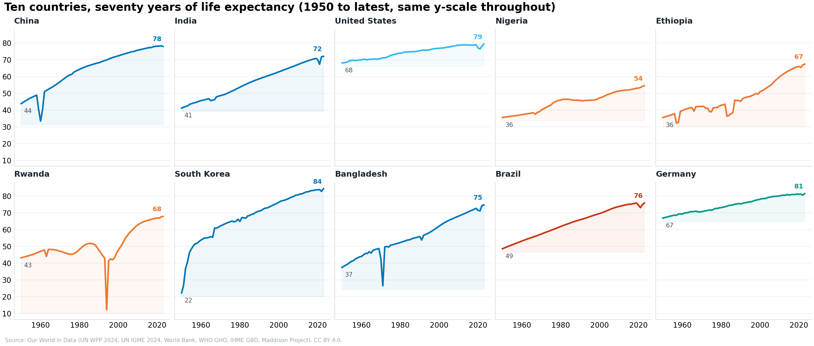
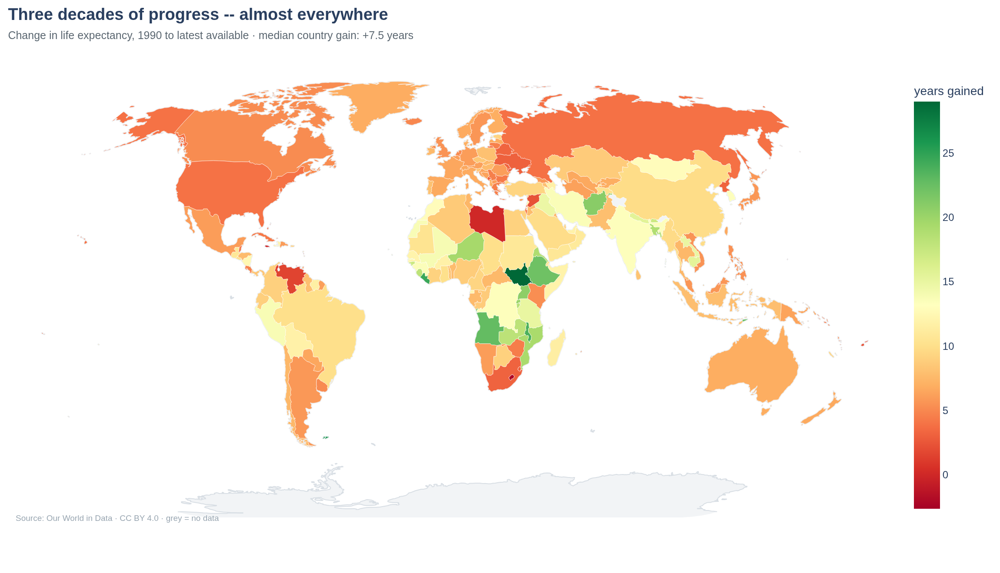

**Since 1990, post-conflict recoveries dominate the gains; the short list of
decliners is a story of epidemic and conflict.**

Largest gains in life expectancy 1990 → latest (countries above 500k
population, country_comparison.ipynb): South Sudan (+29.0), Liberia (+24.5), Malawi
(+23.8), Angola (+22.8), East Timor (+22.5), Ethiopia (+22.2), Afghanistan
(+20.9), Uganda (+20.7), Rwanda (+20.0). These are countries rebuilding
health systems after war, plus the broader African recovery from the HIV/AIDS
era as antiretroviral therapy rolled out. (Where 1990 was the floor, the
rebound is extraordinary — and partly regression toward the mean, which is
why the notebook flags it rather than celebrating it.)

The decliners are few and explicable: Palestine (−2.6), Lesotho (−1.9),
Jamaica (−0.2), Libya (+0.0). Lesotho is the tail of the region's HIV
epidemic; Jamaica's stagnation is the long-run puzzle it has always been; the
others are conflict. The map of change shows the pale belt running from the
southern-African HIV-burden countries through parts of the former USSR, with
the United States (+3.9) conspicuously paler than its income peers.

## Q4. How does child survival compare?

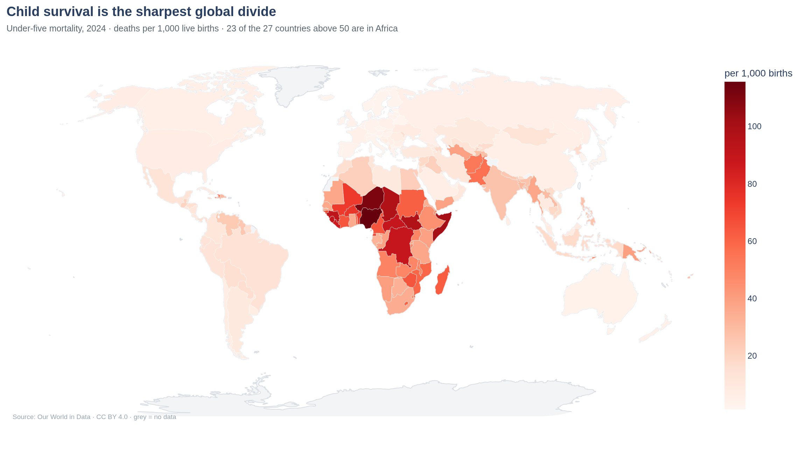

**Child mortality fell 4- to 18-fold per region since 1950 — the single
steepest gradient in global health.**

World under-five mortality fell from 247 to 38 deaths per 1,000 live births
(1950 → 2023). Regional declines (population-weighted, child_survival.ipynb): Africa
310 → 64, Asia 284 → 20, South America 185 → 14, Europe 80 → 4.5. Africa's
smaller multiple is the HIV/AIDS era visible in its own line — a decade of
near-flat progress in the 1990s.

The uncomfortable framing: **Africa's current rate (64 per 1,000) is where
Europe stood in 1954** — a ~69-year lag at current rates. The absolute
Africa–Europe gap has narrowed enormously (from ~230 to ~59 per 1,000), but
the pace comparison is not yet flattering: Africa is improving at about 3% a
year since 2000, while Europe at the same level in the 1950s halved its rate
in 13 years (−5%/yr). At current rates Africa needs roughly two decades just
to halve from here.

The map makes the divide concrete: **23 of the 27 countries still above 50
per 1,000 are in Africa** (the exceptions: Afghanistan, Pakistan, Haiti,
Kiribati). Nigeria — the fifth-largest country by population — combines some
of the weakest outcomes with the largest cohort of children at risk, which
makes it the single most consequential case in this indicator.

## Q5. How do outcomes relate to socioeconomic indicators?

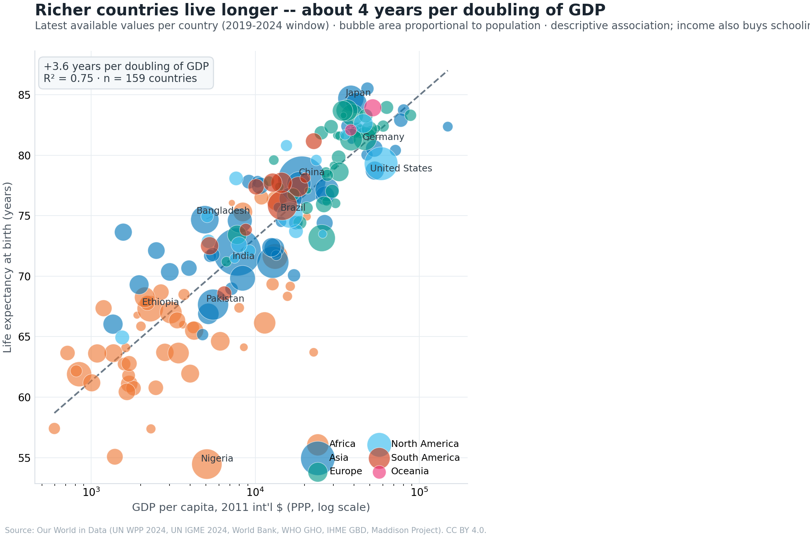

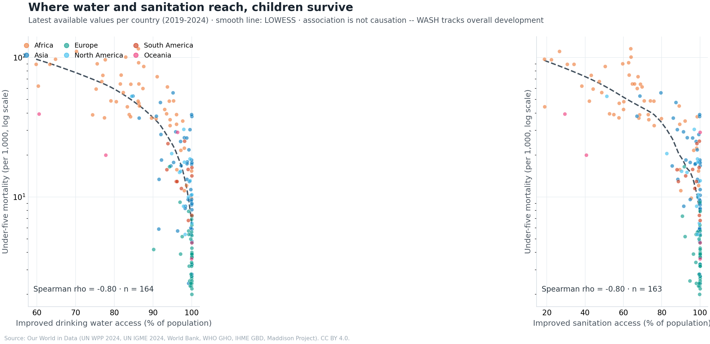
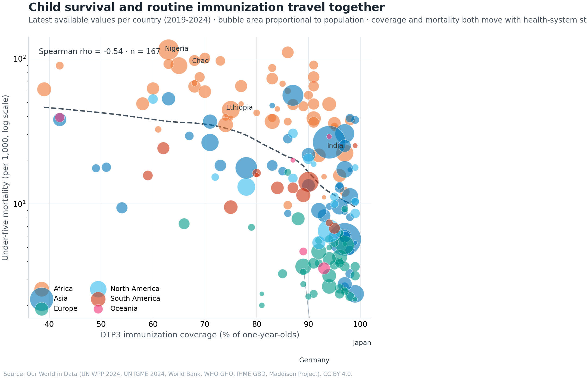
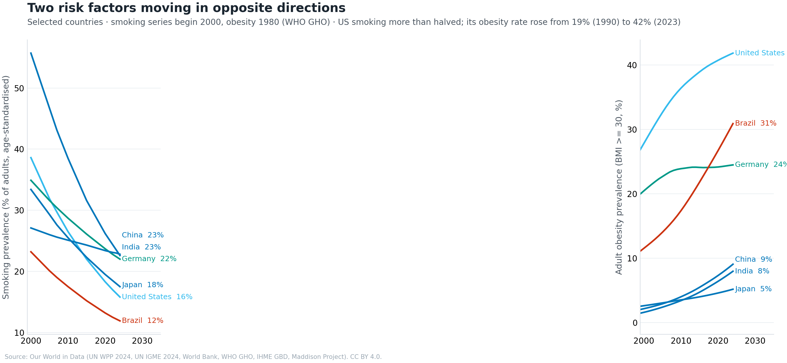
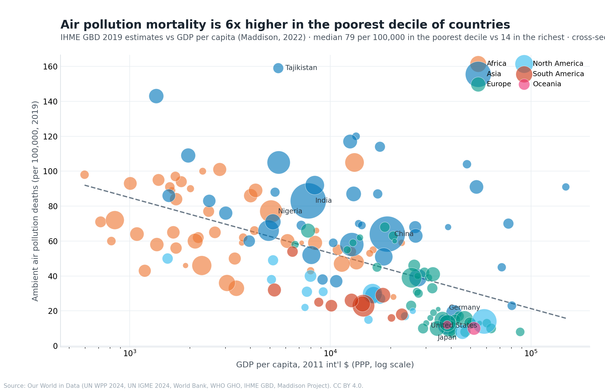

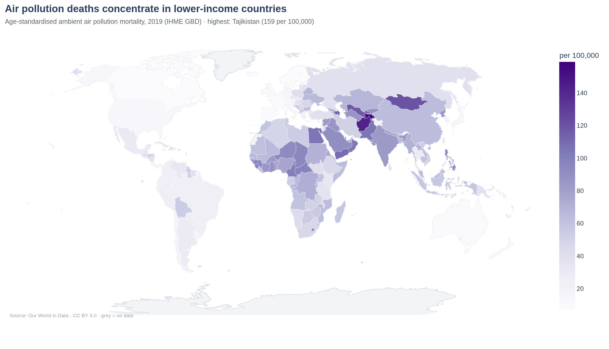

*(Everything in this section is correlation. It exists because the
relationships are strong and informative — not because any of them is a
causal estimate.)*

**Income and health move together — about +3.6 years of life expectancy per
doubling of GDP per capita** (semilog fit, R² = 0.75, n = 159; socioeconomic_links.ipynb).
Child mortality falls ~11.5 per 1,000 per GDP doubling (R² = 0.63). The
curvature is the policy-relevant part: the same doubling buys far more health
at the bottom of the income range than at the top.

**Health spending tracks outcomes too (+3.0 years per doubling, R² = 0.74) —
but the residuals are the policy-relevant part.** Bangladesh, Sri Lanka and
Venezuela live 7–8.5 years *longer* than their spending predicts; Nigeria,
Lesotho and Chad live 9–13 years *shorter*. Southern Africa's below-trend
position is the HIV/AIDS burden; the above-trend countries are the classic
"good health at low cost" cases — primary-care systems, community health
worker programmes, early national immunization and ORT pushes. The United
States, the largest spender per capita by far, sits visibly below the trend
line — the standard observation in cross-system comparisons. A below-trend
residual is not proof of inefficiency; it may be an epidemic, a conflict
legacy, or a different epidemiological profile.

**Water, sanitation and immunization all rank-correlate strongly with child
survival** (child_survival.ipynb): Spearman ρ ≈ −0.80 for both improved water and
sanitation vs under-five mortality, −0.54 for DTP3 coverage. The LOWESS
curves show the WASH relationship steep below ~80% coverage and flattening
near universal access; the DTP3 chart has an empty lower-left corner — no
country has low coverage *and* low child mortality. Coverage behaves like a
floor condition: necessary-ish, far from sufficient.

**The correlation matrix carries its own warning label.** Smoking (ρ = +0.32)
and obesity (ρ = +0.47) correlate *positively* with life expectancy across
countries — because rich, long-lived societies smoke more and eat more, not
because cigarettes are good for you. Income confounds everything in the
matrix (GDP vs life expectancy: ρ = +0.88). It is displayed precisely so the
reader meets the confounding problem in the data rather than in the abstract.

**Risk factors point in opposite directions**: US smoking fell from 38.6%
(2000) to 15.8% (2024) — more than halving — while US obesity rose from ~19%
(1990) to ~42% (2023). Japan's obesity rate remains ~5%. Air pollution
mortality is strongly class-patterned: the median rate in the poorest GDP
decile of countries (~79 per 100,000) is roughly six times the richest-decile
median (~14), with the highest national rate in Tajikistan (~159 per 100,000).

## Summary for a policy audience

1. The long-run direction is unambiguous: every region is far healthier than
   in 1950, and the gap between countries is narrowing (σ-convergence on a
   balanced panel, −40%).
2. The remaining burden is concentrated: child mortality above 50 per 1,000 is
   almost entirely a Sahel-and-equatorial-Africa problem; HIV-burden and
   conflict states fill the stagnation list.
3. Money is neither necessary nor sufficient: system design explains
   multi-year deviations from the spending-trend line in both directions
   (Bangladesh above, Nigeria below, the US off to the right).
4. The risk-factor transition is underway — smoking down in rich countries,
   obesity up nearly everywhere — and will shape the next 30 years of
   mortality differently from the last 30.
5. None of the cross-sectional relationships here is a causal estimate; they
   tell you *where* to look, not *what will happen if*.
